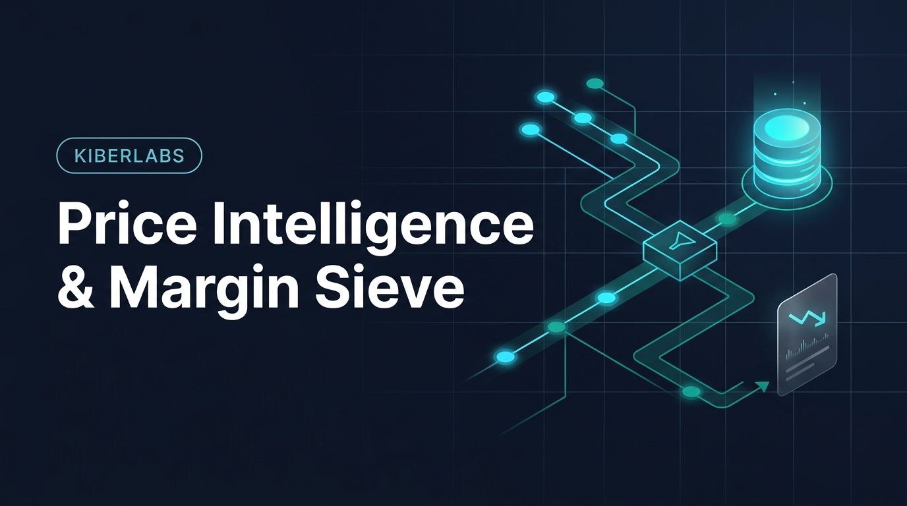
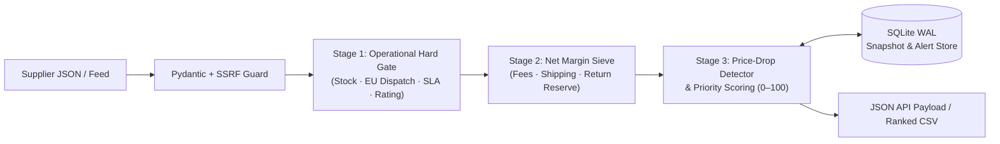

# KiberLabs — E-Commerce Price Intelligence & Margin Sieve

[](https://github.com/Kiberlabs/ecommerce-price-monitor-sieve/actions/workflows/ci.yml)



A deterministic, **zero-token Python price monitoring and unit-economics filtering engine** built for B2B e-commerce teams, wholesale distributors, and marketplace operators.

Instead of burning LLM tokens on noisy supplier feeds, `sieve-monitor` enforces strict operational gates, net-margin thresholds (after marketplace fees, shipping, and return reserves), SSRF input sanitization, and historical price-drop detection backed by concurrent **SQLite (`WAL`)** storage.

---

## Architecture



## Key Engineering Highlights

- **Zero-Token Deterministic Speed:** Evaluates thousands of supplier SKUs per second locally with zero external LLM API cost or latency.
- **True Net-Margin Math:** Accounts for supplier cost, outbound shipping, marketplace commission (`12%` default), and return/refund reserve (`4%` default) before approving any SKU.
- **Concurrent SQLite WAL Persistence:** Configured with `PRAGMA journal_mode=WAL` and `busy_timeout=5000` to prevent reader/writer lock contention during scheduled cron scrapes.
- **Built-in SSRF Boundary Validation:** Rejects non-HTTP schemes, loopback/private IPv4 & IPv6 ranges (`127.0.0.0/8`, `169.254.169.254`, RFC1918), and `.internal`/`.local` hostnames at ingestion time.

---

## Quickstart

```bash
# 1. Run the automated test suite
python -m pytest -v

# 2. Evaluate the sample B2B supplier catalog and export ranked CSV + JSON
PYTHONPATH=src python -m sieve_monitor run \
  --input data/sample_catalog.json \
  --db data/monitor.db \
  --csv-out data/output_ranked.csv \
  --json
```

### Sample Output

```text
[KiberLabs Sieve] Processed=7 | Approved=3 | Blocked=1 | Alerts=0
  + KB-DOCK-TB4  score= 77.7  profit= 44.16 EUR (27.8%) — Thunderbolt 4 Dual-4K Aluminum Docking Station
  + KB-MON-27QHD score= 76.6  profit= 48.46 EUR (22.1%) — 27-inch QHD Ergonomic IPS Office Monitor
  + KB-SCAN-PRO  score= 68.2  profit= 50.16 EUR (20.1%) — High-Speed Duplex Document Scanner Wi-Fi
```

---

## Project Layout

```text
ecommerce-price-monitor-sieve/
├── data/
│   └── sample_catalog.json       # Synthetic B2B catalog (valid, low-margin, OOS & SSRF cases)
├── src/sieve_monitor/
│   ├── models.py                 # Pydantic schemas & SSRF URL validator
│   ├── storage.py                # Concurrent SQLite WAL snapshot & alert store
│   ├── filter_engine.py          # 3-stage deterministic sieve & price-drop detector
│   └── cli.py                    # CLI runner (JSON stdout + CSV export)
└── tests/
    └── test_sieve_monitor.py     # Unit, security (SSRF), SQLite WAL & CLI integration tests
```

---

## License

MIT — Built by **KiberLabs Engineering** (*AI & Python Automation Studio*).
